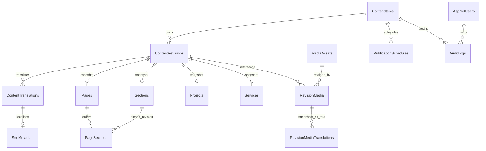

# Database architecture — Phase 5

The dedicated development schema is WebSiteNLOIQDb (normalized by the Windows MySQL server to websitenloiqdb). It now contains 40 tables: 30 content tables, seven standard Identity tables, the two preserved preview tables, and EF migration history. MySQL 8.0.43 and utf8mb4 were verified.

## Content identity and immutable revisions

ContentItems gives every page, section, project, category, service, navigation group, contact group, footer, site setting and theme a stable identity. Kind and Key uniquely identify that item. State is Draft, Published or Archived; Version is an optimistic concurrency token. DraftRevisionId and PublishedRevisionId are separate nullable pointers.

ContentRevisions belongs to one content identity and has a unique per-item revision number. Composite foreign keys ensure draft, published and predecessor pointers refer to that same owner. Each revision is an immutable snapshot. Editing means creating a new revision and moving the draft pointer; it does not overwrite existing content.

ContentTranslations is the normalized translation table for every revision type. Its primary key is (RevisionId, Culture), and cultures are constrained to en/ar. Titles, summaries, body, localized slugs and button labels are stored as rows. Long bodies use longtext with a 16,000-character application limit; indexed text stays bounded. No table duplicates English/Arabic columns.

Typed snapshot tables use RevisionId as their primary key. Thus a project snapshot and its translated content are tied to the same immutable revision. The write guard rejects payload types that do not match the stable content kind.

The diagram shows core relationships; root draft/published pointers additionally select revisions through same-owner composite foreign keys.

## Table map

| Group | Tables and responsibilities |
| --- | --- |
| Identity | AspNetUsers, AspNetRoles, AspNetUserRoles, AspNetUserClaims, AspNetRoleClaims, AspNetUserLogins, AspNetUserTokens; ApplicationUser adds display name and active state |
| Lifecycle | ContentItems, ContentRevisions, ContentTranslations; identities, pointers, immutable content and cultures |
| Pages | Pages, Sections, PageSections; page/section snapshots and pinned ordered section revisions |
| Portfolio | Projects, ProjectCategories, ProjectCategoryAssignments, ProjectMedia; revision-specific video, feature/order, category and gallery links |
| Services | Services; approved icon keys, ordering, visibility and optional revision-owned image |
| Media | MediaAssets, MediaAssetTranslations, RevisionMedia, RevisionMediaTranslations; immutable object metadata, editor alt suggestions, versioned usage and captions |
| Navigation | NavigationSettings, NavigationItems, NavigationTranslations; revision-scoped hierarchy, link targets and labels |
| Contact | ContactSettings, ContactDetails, ContactTranslations, BusinessHours, SocialLinks; typed details, locale labels and optional values |
| Appearance | FooterSettings, SiteSettings, ThemeSettings; revision-scoped content, defaults, logo/favicon references and approved colors |
| Discovery | SeoMetadata and PublishedRoutes; locale-specific metadata and unique active routes |
| Operations | PublicationSchedules and AuditLogs; schedule records/concurrency and append-only audit trail |
| Preserved preview | ServicePreviews, ServicePreviewTranslations; existing development page data until CMS wiring is implemented |
| Migration tracking | __EFMigrationsHistory |

## Versioned relationships and media retention

PageSections points to exact section revisions. Project categories and galleries belong to the project revision. Navigation parents must belong to the same navigation revision. Cover, logo, favicon and Open Graph media references use composite keys so they cannot point to another revision's media usage.

MediaAssets represents immutable file/object metadata: storage provider/key, original name, content type, size, dimensions and SHA-256. Replacing an asset requires a new row/key. Referenced assets cannot be deleted because foreign keys restrict removal. Asset translation rows are editor suggestions; the public alternative text/captions are copied into immutable RevisionMediaTranslations, so later library edits cannot change historical captions.

Three seeded media rows describe actual trusted bundled SVG illustrations, with hashes calculated from their real bytes. This does not implement uploads, image optimization or a storage UI. Those remain Phase 8 work; bundled source assets do not establish an upload allowlist.

## Publication prerequisites and public reads

IPublishedContentReader projects only verified, Published identities through their matching PublishedRevisionId. Draft, archived, demo and stale route records return no public result. A missing culture has no silent fallback.

Moving a published pointer requires both en/ar titles, localized page/project slugs, the correct typed snapshot, bilingual media alt snapshots and verified media. Page section and project category references must point to published verified revisions at the time of publication. Demonstration roots/media are blocked from publication. These are persistence safeguards, not a completed publishing UI.

PublishedRoutes reserves only active localized routes, with unique (Culture, Scope, Slug) and (ContentItemId, Culture) keys. Historical revisions can retain their former slugs without conflicting with current routes. Future publishing services must move routes, pointers and audit records in one transaction. Snapshot restoration, preview tokens, caches and scheduling workers remain Phase 10 work.

## Integrity and validation

- Same-owner composite pointers, required foreign keys and restricted deletes protect revision/media relationships.
- Unique keys cover identity kind/key, owner/revision number, localized rows, active routes, role names and media storage keys.
- Ordering, culture, publication, parallax and media dimensions/size have database constraints where applicable.
- Approved icon/layout/background keys, video IDs, links, field limits and contrast-preserving six-digit theme colors are validated on writes.
- Saved revisions, their child records and audit entries are append-only through NloDbContext. New child records require a newly tracked revision.
- Root and schedule versions reject stale writes. UTC timestamps use datetime(6) and return with UTC kind.
- No administrator/user credentials are seeded. Role definitions are SuperAdmin, Editor and Viewer.

Database constraints enforce relational integrity even for raw SQL; append-only and publication policy checks apply through the application context. A database administrator's direct SQL is outside the application's permission boundary. Future rich-text input/rendering still needs the planned sanitizer in CMS work.

## Seed inventory

All new fixtures are marked demo and Draft; no published route or schedule is created.

| Content | Count |
| --- | --- |
| Home page | 1 |
| Sections | 5 |
| Projects / illustrative studies | 3 |
| Project categories | 4 |
| Services copied from preserved preview | 4 |
| Navigation group | 1 |
| Contact group with no fabricated details | 1 |
| Footer | 1 |
| Site settings | 1 |
| Theme settings | 1 |
| Total identities / revisions | 22 / 22 |
| Translations | 44: 22 English, 22 Arabic |
| Media assets / roles / users | 3 / 3 / 0 |

Initial seed creation is transactional. Rerunning preserves existing content and inserts zero. It is not a tool for restoring manually removed or edited content. Existing nonfixture content conflicts are rejected without overwrite. See PHASE_5_SEED_INVENTORY.json for the actual captured inventory.
